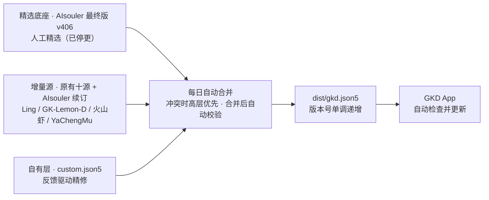

<div align="center">


<h1>清净 · GKD 精选订阅</h1>

<p><strong>集百家之所长 · 每日自动合并维护的 GKD 规则订阅</strong></p>

<p>还你一个清净屏幕。精选底座打底，每日增量补齐，反馈逐条精修——一份订阅，装上就用。</p>

[](https://github.com/Dear-Ded/gkd-subscription)
[](https://github.com/Dear-Ded/gkd-subscription)
[](CHANGELOG.md)
[](https://github.com/Dear-Ded/gkd-subscription/commits/main)
[](https://gkd.li)

</div>

---

## 订阅地址

复制下面这一行，粘贴到 GKD 即可：

```
https://raw.githubusercontent.com/Dear-Ded/gkd-subscription/main/dist/gkd.json5
```

## 快速开始

1. 打开 **GKD** → 进入「订阅」页面 → 点右上角 **+**
2. 粘贴上方订阅地址 → 保存
3. 完成。GKD 会自动定期检查新版本，后续更新无需再做任何操作

> 还没有 GKD？到官网 [gkd.li](https://gkd.li) 获取。GKD 是一款基于无障碍服务的应用界面自动操作工具，本订阅为其提供跳过广告等场景的规则。

## 特性

| 特性 | 说明 |
| --- | --- |
| 精选底座 | 以社区公认的精选订阅 AIsouler 最终版（v406）打底：人工筛选、克制准确、不为凑数堆规则 |
| 每日新鲜 | Lin-arm、奥怪、甘霖、梦念逍遥、Mrlc，以及 AIsouler 自用续订、Ling、GK-Lemon-D、火山虾、YaChengMu 等增量每日自动并入，底座停更后出现的新应用、新版界面规则持续补齐 |
| 反馈精修 | 自有层专修漏跳与误触：依据用户反馈的快照逐条写规则，优先级高于所有上游 |
| 自动校验 | 每次合并后自动校验格式、重复应用、规则组序号与组名，校验不过不发布 |
| 按需发布 | 内容有变化才递增版本号并推送；无变化不打扰，GKD 端不会无谓重拉全量文件 |
| 省流量检查 | 更新检查只拉一个几十字节的版本文件（`checkUpdateUrl`），确认有新版才下载全量 |

## 数据指标

| 指标 | 当前数据（v10） |
| --- | --- |
| 覆盖应用 | 1104 个 |
| 规则组 | 4990 个 |
| 规则条数 | 7759 条 |
| 全局规则组 | 16 个 |
| 订阅文件大小 | 约 2.8 MB |
| 更新频率 | 每日自动合并发布 |

## 多层合并架构

本订阅不是任何单一来源的镜像，而是十五个来源按优先级合并的产物：同应用同名规则组只保留一份，**高层优先**；低层独有的应用与规则组自动补入并重排序号。本轮新增的五个来源排在最后，并且经过误触守卫：选择器已被更高层完整覆盖的组、支付/登录/删除/签到领取、信息流滑动，以及过宽的开屏「跳过」都不会并入。



| 优先级 | 层级 | 来源 | 角色 |
| --- | --- | --- | --- |
| 最高 | 自有层 | 本仓库 `custom.json5` | 针对反馈逐条精修：补漏跳、修误触、禁用坏规则 |
| 高 | 精选底座 | [AIsouler/GKD_subscription](https://github.com/AIsouler/GKD_subscription) 最终版（v406，已停更） | 人工精选、克制准确，同名冲突时以它为准 |
| 中 | 增量（维护中） | [Lin-arm](https://github.com/Lin-arm/GKD_subscription)、[奥怪](https://github.com/aoguai/subscription)、[甘霖](https://github.com/ganlinte/GKD-subscription)、[梦念逍遥](https://github.com/MengNianxiaoyao/gkd-subscription)、[Mrlc](https://github.com/mrlctate/gkd-mrlc)、[少年阿鲲](https://github.com/Lin-arm/gkd-Rules)、[言木七](https://github.com/yanmuq/muqi_gkd) | 仍在维护，补新应用、新版界面规则与各家独门规则 |
| 基础 | 增量（存量精选） | [Adpro](https://github.com/Adpro-Team/GKD_subscription)、[九千院](https://github.com/jiuqianyuan/GKD_subscription) | 已停更，但存量精选规则覆盖面广，补齐历史应用 |
| 补齐 | 增量（本轮新增） | [AIsouler 自用续订](https://github.com/AIsouler/gkd-subscription)、[Ling](https://github.com/cjy0812/Ling033_GKD_Rules)、[GK-Lemon-D](https://github.com/LenorEric/GK-Lemon-D)、[火山虾](https://github.com/VolcanoSAhrimp/gkd-rule)、[YaChengMu](https://github.com/YaChengMu/gkd_subscription_min) | 仍在维护。优先级最低，只填上面没有的应用和规则组，并经过误触守卫 |

合并与校验由 [`scripts/merge.py`](scripts/merge.py) 完成，规则是公开的，任何人可复核。

## 更新机制

- 维护任务每日拉取增量源，与底座、自有层重新合并
- 合并产物先过自动校验（JSON5 格式回读、应用去重、规则组序号与组名唯一、全局组序号与组名唯一），通过后才写入 `dist/`
- 内容与上一版不同才递增 `version` 并推送；GKD 通过 `checkUpdateUrl` 指向的版本小文件比对版本号，决定是否拉取全量
- 每次发布的变更记录见 [CHANGELOG.md](CHANGELOG.md)

## 常见问题

**这份订阅和直接订阅 AIsouler 或 Lin-arm 有什么区别？**
AIsouler 是精选集，但已于 2026 年 2 月停更，新应用和新版界面会逐渐缺规则；Lin-arm 保持每日更新，但走全量聚合路线。本订阅以 AIsouler 为底座，再按优先级并入 Lin-arm、奥怪、甘霖、梦念逍遥、Mrlc、Adpro、九千院、少年阿鲲、言木七，以及 AIsouler 自用续订、Ling、GK-Lemon-D、火山虾、YaChengMu，叠加一层针对真实反馈的自有精修，一份订阅同时拿到各家的长处。

**已经在用 AIsouler 或 Lin-arm，还需要同时开着吗？**
不需要。本订阅在规则覆盖上是两者的合并超集，同时启用会让同一界面的规则重复生效、可能重复点击。在 GKD 里停用或删除旧订阅、只留这一份即可。

**为什么某个广告没跳过，或者偶尔会误触？**
应用改版后界面结构变化，旧规则会失效；个别规则也可能匹配过宽。遇到这类情况请按下方「反馈与共建」提交 Issue 并附快照，修复会写进自有层，随下一次每日更新推送给所有订阅者。

**多久更新一次？我的 GKD 需要手动操作吗？**
仓库每日自动合并发布；GKD 端按其自身的检查周期自动比对版本号并更新，全程不需要手动操作。

**这份订阅收费吗？**
免费、开源。规则著作权归原作者及各贡献者，见下方致谢。

## 反馈与共建

遇到**漏跳**（广告没跳过）或**误触**（点错地方），欢迎提交 Issue——仓库备有专用模板，照着填即可：

[提交漏跳反馈](https://github.com/Dear-Ded/gkd-subscription/issues/new/choose) · [提交误触反馈](https://github.com/Dear-Ded/gkd-subscription/issues/new/choose)

提交时请注意：

1. 注明应用名称与出问题的场景（如「XX 开屏广告没跳」）
2. **务必附上 GKD 快照链接**：在 GKD 里对出问题界面保存快照并分享，得到 `i.gkd.li` 链接。有快照，规则能照着界面节点精确编写，修复最快；没有快照的反馈往往只能靠猜
3. 维护者会把修复写进自有层，随下一次每日更新推送给所有人

## 仓库结构

```
├── dist/
│   ├── gkd.json5           # 订阅文件本体，GKD 订阅的就是它
│   └── gkd.version.json5   # 版本检查小文件
├── custom.json5            # 自有层规则，优先级最高
├── scripts/
│   └── merge.py            # 多源合并与校验脚本
├── assets/                 # 主页视觉资产
└── CHANGELOG.md            # 更新日志
```

## 致谢与说明

本仓库是对社区优秀订阅的**聚合再维护**，规则著作权归原作者及各贡献者所有：

- [AIsouler/GKD_subscription](https://github.com/AIsouler/GKD_subscription) —— 精选底座，感谢作者多年的维护（已归档停更）
- [Lin-arm/GKD_subscription](https://github.com/Lin-arm/GKD_subscription) —— 每日增量来源
- [aoguai/subscription](https://github.com/aoguai/subscription) —— 奥怪的GKD订阅，全局规则来源
- [ganlinte/GKD-subscription](https://github.com/ganlinte/GKD-subscription) —— 甘霖的GKD订阅
- [MengNianxiaoyao/gkd-subscription](https://github.com/MengNianxiaoyao/gkd-subscription) —— 梦念逍遥のGKD订阅
- [mrlctate/gkd-mrlc](https://github.com/mrlctate/gkd-mrlc) —— Mrlc的GKD订阅
- [Adpro-Team/GKD_subscription](https://github.com/Adpro-Team/GKD_subscription) —— AdproのGKD订阅（已停更，存量精选）
- [jiuqianyuan/GKD_subscription](https://github.com/jiuqianyuan/GKD_subscription) —— 九千院的GKD订阅（已停更，存量精选）
- [Lin-arm/gkd-Rules](https://github.com/Lin-arm/gkd-Rules) —— 少年阿鲲的GKD订阅，少数应用的深度规则
- [yanmuq/muqi_gkd](https://github.com/yanmuq/muqi_gkd) —— 言木七的附加订阅
- [AIsouler/gkd-subscription](https://github.com/AIsouler/gkd-subscription) —— AIsouler 停更公开精选后的自用续订（v121）
- [cjy0812/Ling033_GKD_Rules](https://github.com/cjy0812/Ling033_GKD_Rules) —— Ling 自用规则，偏细分与功能
- [LenorEric/GK-Lemon-D](https://github.com/LenorEric/GK-Lemon-D) —— 作为 id667 的补充订阅
- [VolcanoSAhrimp/gkd-rule](https://github.com/VolcanoSAhrimp/gkd-rule) —— 火山虾的GKD订阅
- [YaChengMu/gkd_subscription_min](https://github.com/YaChengMu/gkd_subscription_min) —— YaChengMu 精简续更
- [GKD](https://github.com/gkd-kit/gkd) 本体与所有规则贡献者

许可证：甘霖的订阅为 MIT；奥怪、言木七为 GPL-3.0，这两份规则在本聚合里仍按 GPL-3.0 再分发并保留署名。其余上游多数没有 SPDX 许可证，README 一般为学习交流，AIsouler 旧库、Lin-arm、Ling、YaChengMu 还写有「禁止在国内平台传播 / 仅供学习或本人学习使用」。本仓库只做署名聚合，不把规则著作权收归自己。Ling 的声明与底座同类；若任一原作者反对这种聚合，开 Issue 后会立刻从来源里移除。

本轮还看过官方第三方名单（[Adpro-Team/GKD_THS_List](https://github.com/Adpro-Team/GKD_THS_List)）和 GitHub 上近期仍有提交的订阅。名单里标为仍在维护的源已经在上面。停更超过一个月、写明仅供本人使用、纯二次聚合，或主体是过宽滑动规则的候选没有接进来，取舍记在 [CHANGELOG.md](CHANGELOG.md)。

如原作者对聚合方式有异议，请开 Issue 联系，将立即处理。

## 免责声明

本订阅仅供无障碍自动化操作辅助与学习交流使用。应用界面改版可能导致个别规则失效或误触，使用前请自行判断，风险自担。

---

<div align="center">
每日自动维护 · 有问题请提 Issue 附快照
</div>
